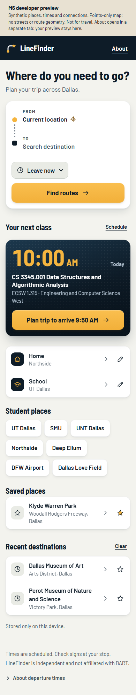
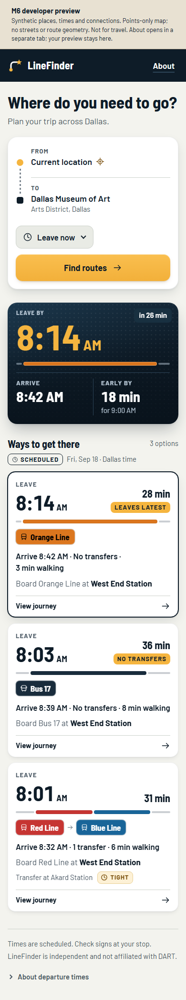
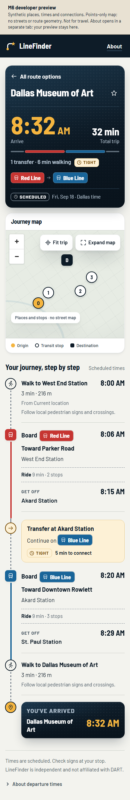

# LineFinder

A mobile-first, independent Dallas/DART transit navigator focused on answering:

**“I want to go there. Tell me exactly how.”**

The project aims to provide concrete bus/rail journey planning, transfers, live vehicle and delay context where legitimately available, and practical replanning when a connection becomes unreliable.

## Status

Live at [linefinder-dart.vercel.app](https://linefinder-dart.vercel.app). It plans
trips from DART's published schedule with our own TypeScript RAPTOR-style router,
Geoapify for walking legs and Mapbox for search and maps. The deployed app includes
the M9C routing work (validated walking transfers, full walking totals and
scheduled transfer risk, see [ADR 0005](docs/adr/0005-routing-quality-and-pedestrian-evidence.md))
and everything under [Features](#features).

DART realtime is **off**. The realtime pipeline is built and tested, but it stays
disabled until permitted access to DART's live feeds is confirmed. Every time in
the app is a scheduled time.

Known limits:

- A walking transfer between two stops needs validated evidence. Being close is
  not enough.
- Each search covers one service day. For trips after midnight, plan on the
  previous service day.
- Arrive-by alternatives leave at most one hour before the latest option.
- There are no walking-only answers, and the map shows places and stops, not
  route lines.
- Scheduled connections are not live predictions. Check DART service notices
  before you travel.

LineFinder is a working name. It is independent and is not affiliated with or
endorsed by DART. The Apache-2.0 license covers this repository's code,
not DART's data or any other third-party dataset. Terms for redistributing the
static feed and retaining provider walking data are still under review.

## Features

- **Leave now, leave at or arrive by.** Arrive-by finds the latest you can leave
  and still make it, optionally arriving up to 30 minutes early, plus alternatives
  with fewer transfers or less walking.
  ([ADR 0006](docs/adr/0006-arrive-by-departure-window-search.md))
- **Departure insight.** After a leave-now or leave-at search, a one-line hint
  appears when leaving up to 15 minutes earlier gets you there at least 10
  minutes sooner, or when you can leave 5 or more minutes later and still arrive
  within 2 minutes. One tap plans the suggested time.
  ([ADR 0007](docs/adr/0007-departure-time-insight.md))
- **Class schedule import.** Load the `.ics` export of your class schedule. The
  file is read in the browser and only the parsed classes are kept, on your
  device. "Your next class" plans a trip that gets you to the building 10
  minutes early, and the app tells you when a trip would mean leaving during a
  class. ([ADR 0008](docs/adr/0008-on-device-class-schedules.md))
- **UTD places.** A class in a room like `ECSW 1.315` routes to a real entrance
  of that building from the official UT Dallas campus map, not its middle. A
  building with no mapped entrance asks you to choose the spot. Quick picks for
  UT Dallas, SMU, UNT Dallas, Northside, Deep Ellum, DFW Airport and Love Field
  each come from an official map or a DART stop record.
- **Step-by-step trips.** Boarding stop, line and direction, where to get off,
  walking legs and every transfer rated Comfortable, Tight or Risky from its
  scheduled slack. Up to three options, ranked as described under
  [Route preference](#route-preference).
- **No account.** Home, School, saved places and recent destinations stay on
  the device.

## Screenshots

<table>
  <tr>
    <th>Home</th>
    <th>Arrive-by results</th>
    <th>Trip detail</th>
  </tr>
  <tr>
    <td valign="top"></td>
    <td valign="top"></td>
    <td valign="top"></td>
  </tr>
</table>

Captured at 390 px from the `/preview` route, which uses synthetic places, times
and connections.

## Core technical goals

- implement a RAPTOR-style transit routing engine
- ingest GTFS Schedule
- integrate GTFS-Realtime where independent-developer access is confirmed
- use PostgreSQL/PostGIS for persistent/spatial data
- use Redis for short-lived realtime state
- expose a Fastify API
- build a mobile-first Next.js PWA
- render trips with MapLibre
- compare selected routing behavior with OpenTripPlanner during development
- maintain deterministic routing tests

## Product scope

Dallas/DART.

The user-facing product is intentionally Dallas-focused.

Core transit/routing code should still avoid unnecessary agency hard-coding.

## Route preference

1. earliest arrival
2. fewer transfers
3. less walking
4. lower transfer risk

Arrive-by puts the latest departure first, then the same order.

## Documentation

Setup is below. For everything else:

- [Development guide](docs/DEVELOPMENT.md): workflow, testing approach, package
  boundaries and local workflows
- [Project spec](docs/PROJECT_SPEC.md), [architecture](docs/ARCHITECTURE.md) and
  [tech stack](docs/TECH_STACK.md)
- [Roadmap](docs/ROADMAP.md)
- [Architecture decisions](docs/adr/README.md)
- [Journey API](docs/JOURNEY_API.md) and [routing core](docs/ROUTING_CORE.md)
- [Deployment runbook](docs/DEPLOYMENT.md)
- [Milestone archive](docs/archive/README.md): review notes from each milestone

## Contributing

See `CONTRIBUTING.md`.

## Prerequisites

- Node.js **24.21.0 LTS**, pinned in `.node-version` (project supports 24.x).
- pnpm **12.4.2**, pinned in `package.json`. Install this version using your preferred
  package-manager setup before continuing; `npm install` is not the project workflow.
- Git and Docker Engine/Desktop with Linux containers and Docker Compose **v2.20+**
  (Compose v5 also works). Start Docker before running infrastructure commands.
- Free local ports **3000**, **3001**, **5432**, and **6379**.

PostGIS's upstream image is amd64-only; ARM machines require Docker's amd64
emulation. See [development notes](docs/DEVELOPMENT.md) for limitations and versions.

## Quick start

```sh
git clone https://github.com/aryansvt/dallas-transit.git
cd dallas-transit
pnpm install --frozen-lockfile
pnpm infra:up
pnpm dev
```

Open <http://localhost:3000>. API probes are
<http://127.0.0.1:3001/health> and <http://127.0.0.1:3001/ready>.
`/health` reports process liveness. `/ready` checks PostgreSQL/schema/activation
and separately reports journey capability; an empty database needs migrations and
an activated publication. `pnpm dev` builds shared runtime modules and starts both
apps with watch/reload support. Use Ctrl+C to stop. The API does not use Redis.

No environment file is required for the default local setup. Optional examples:

- [`infra/docker/.env.example`](infra/docker/.env.example): copy beside it as `.env`
  to override database credentials and infrastructure ports.
- [`apps/api/.env.example`](apps/api/.env.example): copy beside it as `.env` to
  override listener, pool, schedule retention, deadline and walking configuration.
  No walking endpoint is enabled by default.
- [`workers/transit-ingest/.env.example`](workers/transit-ingest/.env.example):
  optional database URLs for the importer and isolated integration tests.

Defaults are **local development only**, not production credentials. Infrastructure
ports bind to `127.0.0.1`; Redis has no password in this local setup. The web app
calls the API through its same-origin `/api/v1` proxy. No CORS override is needed.
See [`apps/web/.env.example`](apps/web/.env.example) for optional API origin and
approved map-style configuration. No public map style is enabled by default.

To review the UI without infrastructure or external providers:

```sh
pnpm install --frozen-lockfile
pnpm dev:preview
```

Open <http://127.0.0.1:3000/preview>. Use **Review state** and **Viewport** to inspect
home, search, results, arrive-by, class schedule, trip detail and failure states
at 320/390/768 px or desktop width. Preview is development-only, uses synthetic
journeys, requests no location permission and never writes saved places to storage.
The source-free map has interactive points, not streets or route geometry. Use
<http://127.0.0.1:3000/> for normal local mode, which requests location once after
mount and falls back to manual origin. Geolocation needs HTTPS or localhost.

## Commands

Run these from the repository root:

| Command                            | Purpose                                                              |
| ---------------------------------- | -------------------------------------------------------------------- |
| `pnpm dev`                         | Start web and API in development                                     |
| `pnpm build`                       | Build every application/package/worker                               |
| `pnpm lint`                        | ESLint across TypeScript and configuration files                     |
| `pnpm typecheck`                   | Check all eight workspaces, including generated Next.js types        |
| `pnpm test`                        | Run Vitest tests across apps, packages, and workers                  |
| `pnpm test:integration`            | Test static ingestion against local PostGIS in an isolated database  |
| `pnpm test:router`                 | Run deterministic routing fixtures and exhaustive checks             |
| `pnpm test:journey`                | Run offline geographic and pedestrian-provider tests                 |
| `pnpm test:api`                    | Run offline API and schedule-lifecycle tests                         |
| `pnpm test:web`                    | Run offline frontend DOM, time, client and state tests               |
| `pnpm dev:preview`                 | Start web-only development; open `/preview`                          |
| `pnpm api:validate --mode fixture` | Validate deterministic journeys through the actual API contract      |
| `pnpm journey:validate --help`     | Show fixture, SQL candidate and configured-provider validation modes |
| `pnpm routing:validate --help`     | Show read-only database-to-router validation commands                |
| `pnpm gtfs --help`                 | Show migration/import/activation/inspection/reset commands           |
| `pnpm format`                      | Apply Prettier formatting                                            |
| `pnpm format:check`                | Check formatting without changing files                              |
| `pnpm infra:config`                | Validate Docker Compose configuration                                |
| `pnpm infra:up`                    | Start PostGIS and Redis and wait for healthy status                  |
| `pnpm infra:status`                | Show local service status                                            |
| `pnpm infra:down`                  | Stop/remove local containers; retain PostgreSQL data                 |

Run the same quality gates as CI:

```sh
pnpm format:check
pnpm lint
pnpm typecheck
pnpm test
pnpm build
pnpm infra:config
pnpm infra:up
pnpm test:integration
pnpm infra:down
```

After building, run production scaffolds in separate terminals with
`pnpm --filter @dallas-transit/web start` and
`pnpm --filter @dallas-transit/api start`. Stop with Ctrl+C, then run
`pnpm infra:down` when finished with the backing services.

## Import a static schedule

Use a locally obtained official GTFS ZIP under the Git-ignored `data/raw/gtfs/`.
The importer does not download feeds or require realtime credentials.

```sh
pnpm infra:up
pnpm gtfs migrate
pnpm gtfs import --archive data/raw/gtfs/dart-recent.zip --source-url https://www.dart.org/transitdata/recent/google_transit.zip
pnpm gtfs inspect
```

Import stages the publication. Inspect its ID and coverage, then explicitly
activate the appropriate service dates. The newest DART publication may start in
the future. See [the complete workflow](docs/DEVELOPMENT.md#static-gtfs-workflow)
for activation, verification, and explicit reset, and
[the schema/import design](docs/STATIC_GTFS.md) for supported fields and limits.
Stop local containers with `pnpm infra:down`; the database volume is preserved.

## Repository

```text
apps/web/                 Responsive planner, journey timeline and MapLibre boundary
apps/api/                 Fastify journey/metadata API and service lifecycle
packages/gtfs/            Streaming static GTFS parsing and normalization
packages/router/          Independent schedule-based routing and reconstruction
packages/realtime/        Experimental realtime mapping (DART live access disabled)
packages/shared/          V1 wire contracts and minimal validated place records
workers/transit-ingest/   Static import CLI, SQL migrations, and orchestration
infra/docker/             Local PostGIS + Redis
docs/                     Specification, architecture, decisions, and setup notes
```

## License

Apache-2.0.
